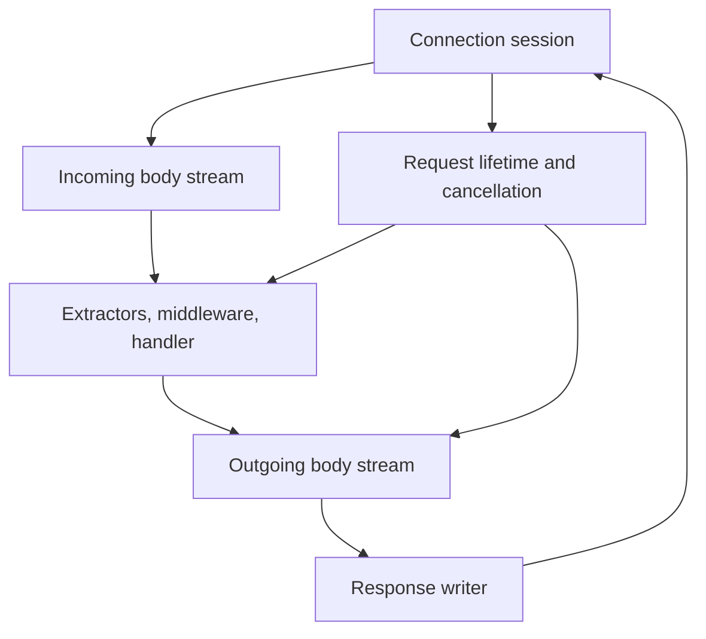

# Porting LeanIO to LeanIn

Date: 2026-10-20.

Reviewed source:

- LeanIO: `0bb212d57f3dba2d76cf601f76a7c431a51c902e`.
- LeanIn: `554e3b0`.
- LeanIO toolchain: Lean `4.33.0`.
- LeanIn toolchain: Lean `4.35.0-rc3`.

Status: source-based porting proposal. No port was implemented or built during this review. Lean and Nix were unavailable in the review environment. Recheck revisions before starting.

## Objective and scope

Preserve LeanIO's route/extractor/middleware programming model while moving its serving, handler, and body-stream execution onto LeanIn.

Distinguish three goals:

| Goal | Meaning | Scope |
| --- | --- | --- |
| Compatibility bridge | LeanIO handlers behind a LeanIn-facing entry point | May retain stock Async tasks, promises, and body channels; useful only as an explicitly labelled interim integration |
| Native LeanIn backend | Handler effects, body streams, and child work use LeanIn | Recommended initial destination |
| Compiled handlers | Selected handler and middleware logic lowers to explicit machines | Subsequent optimisation and compiler-generalisation work |

Do not claim a native port merely because `Router.serve` was replaced. Do not require all higher-order framework code to compile to `async` before the native port can be useful.

## Reusable framework components

Retain where possible:

- Route syntax and compile-time pattern validation.
- Route patterns, trie lookup, literal/parameter/wildcard priority, mounts, and fallback behaviour.
- Path/query/form decoding and deriving handlers.
- Metadata extractors and request extensions.
- Middleware composition order and startup-time precomposition.
- JSON conversion and response-building conventions.
- Multipart boundary-search and chunk-buffer algorithms.
- MIME, caching, ETag, and range interpretation helpers, subject to their existing semantics.

Keep standard HTTP metadata types where they are independent of execution: methods, versions, headers, URI/request targets, status, chunks, extensions, and request/response containers parameterised by body type.

Stable route and middleware closures are acceptable. They are not automatically equivalent to allocating a fresh continuation at every suspension. Measure before redesigning those representations.

LeanIO is MIT-licensed; preserve its copyright and license notices in copied or modified files. Avoid gratuitous namespace and syntax changes during the backend migration.

## Current coupling and required seams

| Source | Current coupling | Porting action |
| --- | --- | --- |
| `LeanIO/Router/Route.lean` | `HandlerFn := Request Body.Stream → ContextAsync (Response Body.Any)`; middleware wraps that type | Introduce a backend-aware handler and body pair |
| `LeanIO/Router/Basic.lean` | `Router.serve` calls `Std.Http.Server.serve` | Add LeanIn startup, configuration, and lifetime adapter |
| `LeanIO/Router/RouteTrie.lean` | Stores concrete `HandlerFn`; dispatch implements Std server handler | Separate route lookup/storage from server instance and native dispatch |
| `LeanIO/Router/Macro.lean` | Quotes `Std.Async.ContextAsync` explicitly into handler bodies | Select backend through expected types or explicit backend syntax/configuration |
| `LeanIO/Router/Extractor.lean` | Recursive extractor instances hard-code `ContextAsync` and body types | Retain extractor rules while changing their effect/body boundary |
| `FromRequestParts.lean` | Even metadata extraction accepts `Request Body.Stream` | Generalise request-body parameter where metadata extraction does not use it |
| `FromRequestBody.lean` | Reads stock `Body.Stream` in `ContextAsync` | Use native body reads, limits, framing, and errors |
| `Response/IntoResponse.lean` | Conversion methods accept computations in `ContextAsync` | Generalise both effect and response-body type |
| Multipart definitions/API/streaming | Store `Body.Stream`; callbacks return `ContextAsync` | Replace stream/effect boundary; retain parsing algorithms |
| `Data/BodyExt.lean` | `StateT σ Std.Async.Async`, stock body iteration and background stream producer | Native transforms and producer lifetime/backpressure |
| Authentication middleware | Validator callbacks return `Std.Async.Async Bool` | Native asynchronous validation |
| File and range responses | Stock body streaming plus ordinary filesystem IO | Native response producer and blocking-I/O strategy |

This is not a mechanical `ContextAsync` rename. The body operations themselves embed the old effect type.

## Proposed backend boundary

Illustrative only:

```lean
abbrev HandlerFn :=
  Std.Http.Request NativeBodyStream → AppM (Std.Http.Response NativeBody)

abbrev Middleware := HandlerFn → HandlerFn
```

Choose a stable application-facing `AppM` with errors, cleanup, request context, cancellation, and supported asynchronous operations. Do not expose the current interpreted `VM` as a permanent framework contract merely because the present HTTP driver accepts it.

A backend-parameterised library and a narrowly maintained LeanIn-specific backend are both reasonable implementation options. Prefer the smallest seam that can support both implementations without duplicating pure routing/parsing logic. For example, the trie can be parameterised by its handler value rather than making every lookup monadic.

Preserve familiar route declarations:

```lean
POST "/todos" (body : Json CreateTodo) => do
  ...
  return (Status.created, result)
```

Do not impose `onDone` callbacks, executor `push` functions, or raw completion cells on application route authors. Those may remain backend mechanisms.

## Body streams are a runtime boundary

In the checked standard-library sources, `Std.Http.Body` methods return `Std.Async.Async`, `Body.Any` stores operations in that monad, and `Body.Stream` is a rendezvous channel built using promises and selectors. The Lean 4.33 implementation supports one blocked producer and one blocked consumer and has no queued capacity.

Keeping these exact body abstractions retains stock async machinery. Introduce native body handles and operations instead, while reusing pure metadata and chunk types where possible.

Specify the native body contract before choosing its representation:

- Chunk receive, EOF, and body/transport failure as distinguishable outcomes.
- Known length and length validation.
- Close/abandon semantics for both reader and writer.
- Backpressure, including maximum queued bytes rather than only chunk count.
- Cancellation and removal of parked producers/consumers.
- Ownership of consumption; concurrent body readers should not silently duplicate or steal bytes.
- Response producer lifetime and failure propagation.
- Optional readiness/selection features actually required by consumers.

If a bounded queue replaces Std's rendezvous behaviour, document the changed buffering contract and test it. Existing LeanIn channel primitives are candidates, not drop-in proof of HTTP stream compatibility: audit closure, errors, cancellation, and EOF support.

## Extend the connection session, not only the handler type

LeanIn currently accepts:

```lean
H1.Head → VM (H1.ResponseHead × ByteArray)
```

This is head-only dispatch with a fully buffered response. LeanIO needs an incoming body that the handler can read and an outgoing body that can be generated incrementally.

The current pump handles header events but does not expose body-chunk events to application code. Replace that omission with an explicit request-body delivery path.



The session must continue progressing while the handler is suspended. A driver that waits for the handler, when the handler waits for body bytes only that driver can deliver, deadlocks. A bounded channel also deadlocks if the session blocks producing a chunk before allowing its consumer to run.

Use cooperating activities or an equivalent resumable session state machine. This does not require several OS threads. Keep each connection's read/parser state, handler state, and response-write progress coordinated under the intended execution owner.

Define how an unread request body is drained or causes connection closure before processing a subsequent keep-alive request. Do not parse unconsumed body bytes as a new request. Preserve response ordering for pipelined requests and half-close behaviour where supported.

## Protocol coverage and metadata conversion

LeanIn's own H1 engine documents Content-Length-only request framing; chunked transfer and `Expect: 100-continue` are outstanding. Its custom method type collapses additional methods into `other`, while LeanIO exposes a much wider method set. Preserve the original method token or reject unsupported methods explicitly rather than mapping distinct methods to one value.

Select one of these paths deliberately:

1. Extend the custom H1 engine for the declared ported feature set.
2. Provide a compatibility backend using standard HTTP protocol code driven through LeanIn's native runtime/body layer.

Using standard HTTP data or pure protocol code does not inherently require using the stock scheduler. The second path may reach broad feature coverage sooner; benchmark the resulting backend rather than assuming it preserves the custom parser's speed.

Audit adapter semantics for URI parsing/decoding, duplicate headers, method/version values, request extensions, and peer address. LeanIO's remote-address extractor needs actual transport metadata. Preserve distinctions such as encoded separators rather than decoding and reparsing targets inconsistently.

Track unsupported features explicitly. Unknown-length response streams need suitable framing or a documented close-delimited policy. Fully buffering every body is not a full streaming port.

## Cancellation, errors, and filesystem work

`ContextAsync` provides a cancellation context over stock `Async`. Map its required semantics to an explicit LeanIn request scope rather than dropping the context parameter.

On client disconnect, cancellation, or shutdown, specify what happens to:

- A handler parked on a body read.
- A producer parked on a full/unconsumed response stream.
- Multipart parser state and file handles.
- Child authentication/backend requests.
- Queued writes and late completions.

Every terminating handler/producer must have an observable outcome. Do not inherit the current compiled-machine possibility of ending a path without resolving its completion handle.

Verify middleware error scopes and cleanup across suspension. Test failure before and after a genuine park, exceptions from lifted IO, response-conversion failure, and downstream failure outside a catch scope. A similarly named `MonadExcept` or `MonadFinally` instance is not evidence of equivalent behaviour.

LeanIO's file upload/download helpers perform ordinary filesystem reads/writes inside async functions. Route potentially blocking work through a blocking pool or a suitable asynchronous file backend. Do not move those calls unchanged onto the only carrier and assume the monad makes them nonblocking. Preserve sequential file offsets and bounded buffering when offloading chunks.

## Staged implementation plan

### Stage 0: align versions and establish reference behaviour

- Build LeanIO with the shared target toolchain and record required compatibility edits separately.
- Run existing routing, trie, multipart-header, and body-transform tests.
- Establish observable reference cases for middleware order, path/query extraction, JSON errors, route misses, method mismatch, and response headers.
- Retain exact source revisions and license notices.

### Stage 1: native metadata-only routed application

- Port handler/middleware and metadata extraction boundaries.
- Serve GET routes, path/query values, extensions, and buffered JSON/text responses through LeanIn.
- Include a handler that genuinely suspends on a LeanIn operation, with a sibling request completing while it is parked.
- Port logging/error middleware and at least one asynchronous authentication validator.
- Audit executed calls for accidental stock Async task/promise dispatch, not merely imported module names.

Acceptance: same declared route/application behaviour, native execution confirmed, and no stock serving-loop bridge hidden behind the new startup API.

### Stage 2: bounded buffered request bodies

- Deliver framed body bytes to bounded accumulation before invoking body-dependent handlers, or through the new native reader as appropriate.
- Port JSON, plain text, and URL-encoded form extraction.
- Reject oversized/truncated bodies correctly and retain keep-alive framing boundaries.

Acceptance: a POST body split across several arrivals produces the expected extracted value; an oversized body is rejected; a truncated body reports failure; the following keep-alive request is not confused with body data. Label this stage buffered, not streaming.

### Stage 3: native streaming

- Implement native body read/write/close/error/backpressure semantics.
- Port multipart streaming, file/range responses, and body transformations.
- Ensure the session progresses concurrently with suspended body consumers and producers.
- Add cancellation, resource cleanup, and drain/shutdown behaviour.

Acceptance: large uploads/downloads stay within the configured buffering bound, slow peers apply backpressure, and disconnects release parked work and resources.

### Stage 4: compiled application paths

- Add compiled handler entry points behind the same framework contract.
- Preserve reusable ordinary Lean helpers and middleware composition.
- Optimize demonstrated allocation sites rather than requiring every stable framework closure to disappear.

Acceptance: equivalent results and lifecycle behaviour between native reference handlers and compiled handlers, with separately measured performance.

## Tests that should decide readiness

| Area | Required observation |
| --- | --- |
| Routing | Literal/parameter/wildcard priority, mounts, fallback, 404/405 behaviour, middleware ordering |
| Request metadata | URI/query decoding, repeated headers, extensions, remote address |
| Bodies | Empty body, fragmented body, body limit, truncation, unread body followed by keep-alive |
| Streaming | Slow consumer/producer, bounded memory, close and error wake parked peers |
| Multipart | Boundaries split across arrivals, sequential entry consumption, discard, save failure |
| Responses | Known/unknown lengths as supported, range responses, disconnect mid-write |
| Errors | Catch scope before/after suspension, lifted IO errors, finally/cleanup exactly once |
| Cancellation | Disconnect, timeout, scope exit, shutdown, late completion |
| Runtime | Genuine suspension does not block siblings; blocking filesystem work stays off the carrier |

Preserve current behaviours intentionally, including any compatibility quirks. For example, LeanIO's HEAD dispatch includes documented behaviour tied to the current writer; do not silently change it as an incidental backend conversion. Review protocol corrections separately from compatibility work.

Follow LeanIn `AGENTS.md` for executable-contract scenarios and synchronized fakes. Keep model proofs, executable observations, and source-to-runtime claims distinct. Use existing fixtures rather than creating an unrelated test framework.

## Performance expectations and deliverables

Establish correctness and native execution before claiming a speedup. The existing hello-handler benchmark does not predict multipart, JSON, file-serving, or middleware performance.

Compare equivalent endpoints on the original LeanIO backend and native LeanIn backend: static GET, path/query plus JSON, fragmented JSON POST, slow upload, and streamed file/range response. Match body sizes, deadline policies, and buffering limits. Report throughput, CPU/request, tail latency, errors, and buffered-memory high-water marks.

Deliver an explicit supported-feature table, adapters and backend API, ported examples, executed checks, and known unsupported operations. A minimal native routed server with a suspending handler is the first reviewable milestone. No upstream PR, remote publication, or merge is required by this handoff.

## Source references

- [LeanIO revision](https://github.com/ecyrbe/leanio/tree/0bb212d57f3dba2d76cf601f76a7c431a51c902e).
- [Handler and middleware types](https://github.com/ecyrbe/leanio/blob/0bb212d57f3dba2d76cf601f76a7c431a51c902e/LeanIO/Router/Route.lean).
- [Route macro backend ascriptions](https://github.com/ecyrbe/leanio/blob/0bb212d57f3dba2d76cf601f76a7c431a51c902e/LeanIO/Router/Macro.lean).
- [Extractor composition](https://github.com/ecyrbe/leanio/blob/0bb212d57f3dba2d76cf601f76a7c431a51c902e/LeanIO/Router/Extractor.lean).
- [Body extractors](https://github.com/ecyrbe/leanio/blob/0bb212d57f3dba2d76cf601f76a7c431a51c902e/LeanIO/Request/FromRequestBody.lean).
- [Response conversion](https://github.com/ecyrbe/leanio/blob/0bb212d57f3dba2d76cf601f76a7c431a51c902e/LeanIO/Response/IntoResponse.lean).
- [File producer](https://github.com/ecyrbe/leanio/blob/0bb212d57f3dba2d76cf601f76a7c431a51c902e/LeanIO/Response/File/Utils.lean).
- [LeanIO-era standard body contract](https://github.com/leanprover/lean4/blob/v4.33.0/src/Std/Http/Data/Body/Basic.lean).
- [LeanIO-era standard stream implementation](https://github.com/leanprover/lean4/blob/v4.33.0/src/Std/Http/Data/Body/Stream.lean).
- [LeanIn HTTP driver](https://github.com/scidonia/leanin/blob/554e3b0/LeanIn/Runtime/Http.lean).
- [LeanIn H1 protocol engine](https://github.com/scidonia/leanin/blob/554e3b0/LeanIn/Http/H1.lean).
