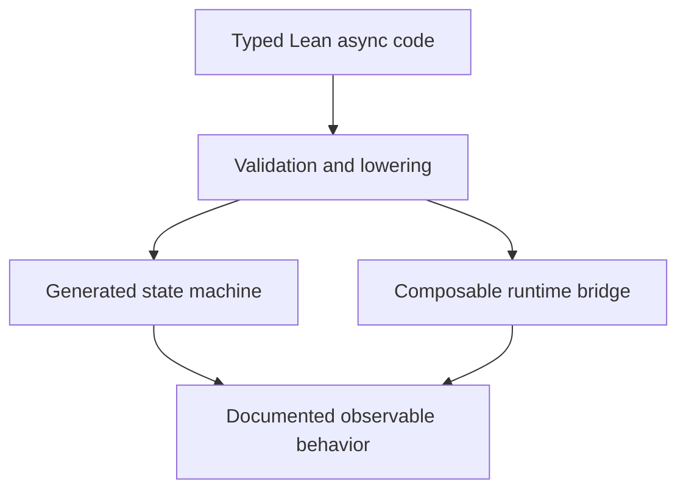

# LeanIn authoring surface: assessment and implementation handoff

Date: 20 October 2026

## Recommendation

Make ordinary typed Lean monadic code the authoring contract, and make state-machine compilation an implementation of that contract. The LeanIO port already demonstrates much of the surface we should aim to preserve: ordinary functions, `do`, `←`, middleware composition, and application capabilities supplied through an environment.

The compiled `async` syntax is useful and readable, but currently exposes completion callbacks, scheduling routes, state-threading conventions, and a syntactically classified effect set. Those are reasonable implementation constraints for an initial compiler; they should not become permanent application-level obligations.

Keep `async` as the public name. This proposal concerns its meaning and ergonomics, not another rename. Whether declarations ultimately use `async name` or `async def name` is secondary to composition, results, and lifetime semantics.

## Review scope and evidence

Source reviewed:

- LeanIn main at [`a7e8e9ca4fef75b6eff665925ff17aaf9ff35029`](https://github.com/scidonia/leanin/tree/a7e8e9ca4fef75b6eff665925ff17aaf9ff35029).
- Scidonia LeanIO's `leanin-native` branch at [`c9adb0102a4899a6b7b36b404eb08149ac576f76`](https://github.com/scidonia/leanio/tree/c9adb0102a4899a6b7b36b404eb08149ac576f76).

This is a source-level design assessment. No compilation, execution, or benchmark validation was performed for this review. The reported 10×+ port speedup is user-reported context, not a measurement established here. Subsequent changes should be checked against these pinned observations before implementation.

## What already works well

The port's native handlers use an attractive sequential surface. For example, the existing echo handler binds `req.body.readAll` and responds through its writer inside an ordinary `do` block. Suspension does not require a callback rewrite by the author.

`AppM := ReaderT Env LeanIn.Runtime.VM` gives route code ambient access to request capabilities. Helpers and middleware remain ordinary functions. The route syntax also supports typed extractors and response values, so routine HTTP code need not mention completion cells or executor queues.

The compiled surface has worthwhile foundations too: explicit suspension sites, familiar branching and loops, liveness-driven state generation, shared continuation states for converging branches, and diagnostics that reject unsupported forms rather than inventing field types. Generated states remain useful for inspection and reasoning.

Preserve these strengths. In particular, do not require application authors to give up ordinary helper functions or higher-order middleware to obtain compiled execution.

## Current friction and desired behavior

| Current compiled surface | Authoring consequence | Desired direction |
| --- | --- | --- |
| Last-parameter `onDone` callback; `halt` and terminal-path conventions | Authors implement the result-delivery protocol themselves | Declared result type and ordinary `return`; generated completion machinery |
| Calls through generated `.run` | Extracting a helper changes how it is called | Ordinary typed calls with a supported lowering or bridge |
| `.spawn push …` | Executor delivery details enter application signatures | Spawn obtains its route from execution context |
| Special first carried parameter | Parameter order has operational significance | Ordinary parameters; compiler determines state representation |
| Field types inferred partly from syntax and later uses | A refactoring across a suspension can require surprising annotations | Elaborate types before lowering; retain explicit annotations as optional assistance |
| Closed syntactic effect classifier | A wrapper around a known operation can cease to be awaitable | A documented extension/bridge protocol |
| Destructuring `let` rejected | Normal Lean idioms require manual projections | Ordinary binding patterns in the supported subset |
| `for` lowered through `.size` and indexing | Familiar syntax has a narrower collection contract than general Lean iteration | Support normal iteration where feasible, or diagnose/document the restriction precisely |

`try`/`catch`, `finally`, early return, mutable local state, and common `do` macros should each have an explicit support policy. Their availability in the monadic layer does not establish their availability across suspension in the compiled subset.

## Correctness-facing surface issues to resolve first

### Preserve the operands the author supplies

In the reviewed compiler, classification discards the source connection operand for ordinary raw reads, writes, and close. Lowering uses the first carried parameter instead. Ordinary `recvRaw` also lowers with a fixed size of 65536 rather than preserving the supplied size.

This undermines a natural program such as copying from one connection to another. The source can appear to name two resources while the lowering directs operations to one.

Required action: carry the receiver and relevant arguments through classification and lowering. If an operation cannot support a supplied receiver or size, reject that source form explicitly. Do not silently substitute another operand.

Acceptance scenario: two distinguishable connections and deliberately different read sizes; observe which endpoint receives each operation and which size reaches the primitive. A compilation success alone is insufficient.

### Make failure policy independent of retaining a result

An unbound compiled send currently ends its path on failure, whereas a bound send supplies the whole `Except` to the body. Binding versus discarding therefore changes control flow and error handling.

Choose one ordinary contract: operations raise through the computation's error channel, or operations explicitly return an error value. If both variants are useful, give them distinct APIs, such as a raising operation and an explicit `attempt`/result-returning operation.

Acceptance scenario: run the same failing write with its success value bound and discarded; the externally visible failure/cleanup policy must agree unless the source explicitly chooses a different policy.

### Generate result delivery

Expose a result type and `return` rather than asking users to call `onDone`. A child handle should resolve exactly once for supported terminal outcomes, including failure and cancellation once those are supported. This does not promise that every computation terminates.

EOF and transport failure should follow a documented computation contract rather than silently ending a callable path without delivering its outcome.

## Proposed authoring shape

The following is design notation, not currently supported LeanIn code. Names and syntax are provisional.

```lean
async def copy (src dst : Conn) : Async Unit := do
  while let some chunk ← src.recv 65536 do
    dst.sendAll #[chunk]
```

The function uses normal parameters and produces a normal result. Its caller or resource bracket owns connection lifetime; this example does not imply automatic ownership of either socket.

For independent work:

```lean
async def fetchBoth : Async (Profile × Settings) := do
  withScope fun scope => do
    let profile ← scope.spawn fetchProfile
    let settings ← scope.spawn fetchSettings
    return (← profile.join, ← settings.join)
```

The important requirements are different result types for children, implicit scheduling context, result-bearing joins, and a defined scope-exit policy. The example does not choose whether an exceptional scope exit cancels and joins children, or applies another explicit policy; that contract must be settled before exporting the API.

Explicit `await` can remain if it improves readability. It should not be what makes arbitrary helper calls non-compositional. Likewise, a returned handle is not a reason to allocate a completion cell for every sequential call: direct calls can retain the existing efficient continuation path.

## Concurrency ergonomics are lifetime semantics

The port currently provides `AppM.onExit`, a shared request cancellation flag, and `AppM.spawn`. This is useful progress, but the reviewed `spawn` returns no join handle, and children respond to cancellation through explicit `checkCancelled` calls. This is not yet a guarantee that every child has stopped before request cleanup runs.

Before calling the surface general-purpose, specify:

1. **Child ownership:** which scope owns each child, whether detachment is permitted, and how child errors are observed.
2. **Scope exit:** whether children are cancelled, joined, or allowed to continue; when resources become unavailable to them.
3. **Cleanup:** whether it may suspend, its ordering, how cleanup failures interact with the original outcome, and whether cancellation can interrupt it.
4. **Races/timeouts:** whether the loser is cancelled, whether its registrations are withdrawn, and whether return waits for its cleanup.
5. **Cancellation:** where it is observed, how a parked operation is woken or retired, and how cancellation differs from an ordinary catchable error.

Keep the application's ordinary error channel distinct from transport aborts where the HTTP driver requires that distinction. However, transport-specific policy should sit at the connection/request boundary rather than becoming the universal meaning of every async primitive.

## Implementation direction

Aim for one authoring contract with several execution paths:



This is a target architecture, not a claim that the current VM and compiled paths already have identical semantics.

Investigate elaborating the body before state-machine extraction, so types, local bindings, and resolved calls are available to the lowering. This is a compiler project, not a small parser adjustment. Start with a bounded supported subset and precise diagnostics rather than promising compilation of arbitrary monadic Lean code.

Decide an extension mechanism deliberately. Options include a registry of lowering rules keyed by resolved declarations, a small typed suspension protocol, or a compositional fallback at unsupported calls. Compare their complexity and runtime costs with representative helpers before selecting one. A fallback must preserve the documented failure, cancellation, and cleanup behavior, not merely the result type.

Do not make the current free-machine representation or its same-type concurrency restrictions permanent public API constraints. The reviewed VM's representation limits are not evidence that heterogeneous child handles are impossible in Lean generally.

## Suggested delivery order

### 1. Repair semantic surprises

Preserve operation receivers and arguments; make failure policy explicit; ensure callable machines deliver their documented terminal outcomes. These changes should precede syntax expansion.

### 2. Remove routine plumbing

Introduce result-bearing declarations and compiler-owned completion. Hide `push` inside execution context. Keep direct sequential calls cheap and expose generated `.run`/state declarations primarily for integration, inspection, and proofs.

### 3. Establish ordinary composition

Support typed helpers, destructuring, and the common control-flow forms needed by actual LeanIO handlers. Document the compiled subset and the bridge behavior. Improve type inference by working from elaborated information where feasible.

### 4. Complete the lifetime API

Add result-bearing child handles and explicit scopes; settle cancellation, cleanup, timeout, and race contracts. Adapt the HTTP request scope to the same general mechanisms where its semantics fit.

## Acceptance programs and checks

Use programs that reveal authoring and semantic constraints rather than tests that merely mirror compiler output:

| Program | What it should establish |
| --- | --- |
| Two-socket relay | Receivers are preserved, EOF can be handled explicitly, read sizes are honored |
| Handler factored into helpers | Refactoring preserves results, errors, and suspension behavior |
| Two children returning different types | Concurrency is not restricted to a shared result type |
| Failure after a suspension inside a local catch | Error handling has the documented lexical scope |
| Timeout while a child is parked | Loser policy, registration retirement, and cleanup are observable |
| Streaming handler whose peer disconnects | Request abort reaches the boundary and resources have one cleanup owner |
| Bounded producer/consumer with early exit | Backpressure and cancellation cooperate without abandoning a waiter |

Follow the repository's executable-contract idiom. Use deterministic staged completions or harness clocks where needed; retain the stated limits of each observation. For any interpreted/compiled equivalence claim, compare externally visible behavior on both paths and state what remains unproved.

After semantic checks pass, measure representative workloads to ensure the authoring improvements preserve useful performance. Include direct helper calls, genuinely suspending handlers, and streaming; avoid inferring general overhead from an immediate-response route alone.

## Source pointers

- [Async compiler and syntax](https://github.com/scidonia/leanin/blob/a7e8e9ca4fef75b6eff665925ff17aaf9ff35029/LeanIn/Async.lean)
- [Current authoring guide](https://github.com/scidonia/leanin/blob/a7e8e9ca4fef75b6eff665925ff17aaf9ff35029/docs/async-guide.md)
- [VM and raw completion cells](https://github.com/scidonia/leanin/blob/a7e8e9ca4fef75b6eff665925ff17aaf9ff35029/LeanIn/Runtime/VM.lean)
- [Compiled hello server](https://github.com/scidonia/leanin/blob/a7e8e9ca4fef75b6eff665925ff17aaf9ff35029/LeanIn/Exe/Hello.lean)
- [Monadic streaming example](https://github.com/scidonia/leanin/blob/a7e8e9ca4fef75b6eff665925ff17aaf9ff35029/LeanIn/Exe/StreamEcho.lean)
- [LeanIO native backend, AppM, request scopes](https://github.com/scidonia/leanio/blob/c9adb0102a4899a6b7b36b404eb08149ac576f76/LeanIO/Backend/LeanIn.lean)
- [LeanIO native authoring examples](https://github.com/scidonia/leanio/blob/c9adb0102a4899a6b7b36b404eb08149ac576f76/LeanIO/Examples/Native.lean)
- [LeanIO route syntax](https://github.com/scidonia/leanio/blob/c9adb0102a4899a6b7b36b404eb08149ac576f76/LeanIO/Router/Macro.lean)

## Implementation status (2026-10-21)

Resolved in `v0.2.0` (`edaa99a`):

- Raw effects carry the authored receiver and read size through classification and lowering; `async-operands.sh`
  observes seven bytes read from one of two connections and written to the other.
- Bound and unbound sends share one policy: the `Except` is returned to a bound result and discarded by an
  unbound one, and the continuation runs in both cases.
- `np_uv_take` now consumes exactly the completed byte count, so a submitted read size is honored even when
  bytes were already buffered by the shim. The previous whole-buffer take made the size advisory at delivery.

Still open from this handoff:

- Result-bearing declarations and compiler-owned completion; `onDone` remains the callable-machine contract.
- Typed helper lowering / extension rules, destructuring `let`, and the collapsed effect classifier.
- Result-bearing child handles, explicit scopes, and the cancellation/cleanup/timeout lifetime contract.
- ~~A dedicated runtime fixture for the send-failure policy~~ — added as `tests/async-failure.sh`: a peer RST
  and a delayed megabyte write, with both bound and unbound machines required to reach a terminal.
