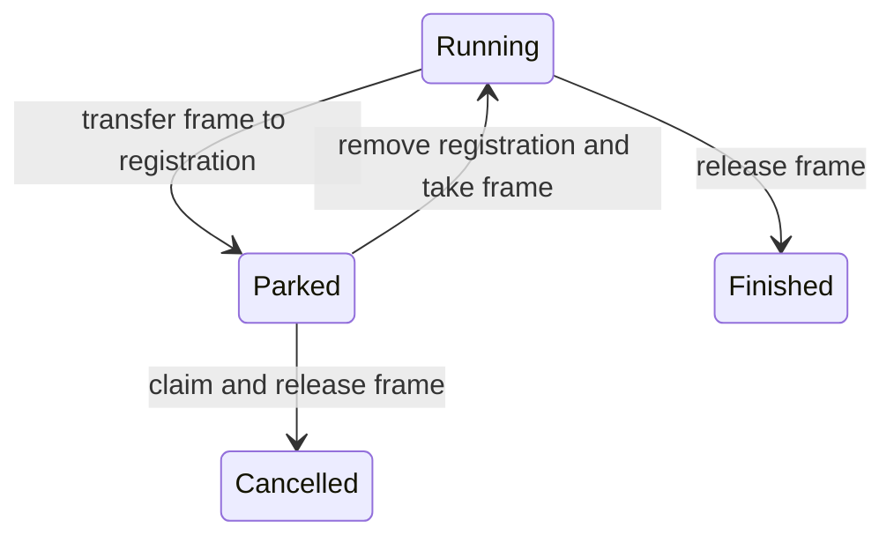
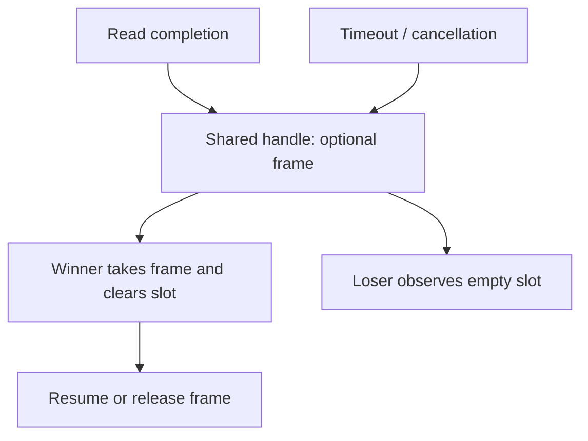

# Suggestion: reusable async frames in LeanIn

Date: 2026-10-19. Status: proposed experiment, not an established allocation guarantee.

## Proposal

Explore compiling an async invocation to a fixed-layout frame that passes through suspension and resumption under exclusive ownership. Use Lean’s existing reference-counting and constructor-reuse optimisation to update the frame in place. Start in safe Lean with ordinary functional record updates; inspect the generated code before considering runtime or FFI changes.

The hypothesis is that a frame can survive many read/write cycles without a fresh frame allocation on each cycle. This is separate from eliminating callback allocations or completion-registration allocations. Measure all three independently.

## Current implementation and scope

Source inspection covered `main` at `a556951` and `feature/async-machine-driver` at `cb7323e`. Recheck the chosen branch before implementation.

- `LeanIn/Async.lean` generates an inductive state type and a `step` function. Its suspension lowering still creates callbacks for raw operations.
- `LeanIn/Runtime/Io.lean` parks callbacks in a raw completion table keyed by connection and operation. Completion removes and invokes a callback directly, avoiding the task-cell/work-item/inject path.
- `LeanIn/Runtime/VM.lean` represents effects explicitly but retains function continuations. It should not be treated as an already closure-free representation.

Keep the raw delivery mechanism as the baseline. The proposed change concerns storage and ownership of the compiled invocation’s state. Initially target a small read/write loop, then the production HTTP driver, rather than redesigning the general VM at the same time.

## Why this is plausible

Lean supports reuse of exclusively owned constructor allocations. Functional record reconstruction can become field mutation when the old value is consumed and the compiler identifies a suitable reuse opportunity. If sharing prevents reuse, allocation preserves functional semantics.

Two conditions must be distinguished:

1. The old frame is exclusively owned at the update boundary.
2. The compiler emits reuse for that reconstruction.

The first enables the second; it does not prove the second. A single carrier prevents simultaneous execution on that carrier, but does not prevent multiple references or callback reentrancy.

## Suggested representation

Use one single-constructor frame with a program-counter field and slots for values live across suspension. Keep its physical layout fixed for the initial experiment. Different generated state constructors with different field counts make reuse more difficult to predict.

Illustrative Lean shape, not a tested implementation:

```lean
structure Frame where
  pc     : UInt32
  input  : ByteArray
  offset : USize

def advance (f : Frame) : Frame :=
  { f with pc := 2, offset := f.offset + 1 }
```

Keep transition functions small enough for the compiler to see consumption and reconstruction. A fixed layout avoids size changes but is not itself a guarantee of reuse. Avoid retaining an old frame for diagnostics, tracing, retry, or comparison across an update.

Clear dead object fields at state changes so the frame does not retain old buffers or protocol values. A larger fixed frame may trade allocation churn for increased resident memory; record both.

## Ownership protocol



The invariant is one logical owner of the frame: the running invocation or its parked registration. Queue entries and external notices should carry IDs where possible, rather than additional frame references.

Logical ownership must be checked against actual runtime references. In particular, a callback can own a frame while parked, but the callback object may still retain a reference while invoking its body. Investigate closure application and reference release at this boundary; do not assume “one-shot callback” implies reference count one at entry to the frame-update function.

The existing raw-table lookup/removal sequence can also temporarily retain references through local values. Inspect their lifetimes through callback application. Taking a callback out of a table is the intended ownership transfer, not sufficient evidence that every temporary alias is already gone.

Frame ownership and payload ownership are independent. Reusing the outer frame does not require an exclusively owned byte buffer. Mutating that buffer in place does require its own uniqueness condition.

## Timeouts and cancellation

Begin with one pending operation and no timeout. Add competing completion paths only after the simple ownership transfer is understood.

For a read-versus-timeout race, avoid making both callbacks capture the frame directly. Consider a shared handle containing an optional frame. Each contender asks to take it; only the winner obtains the frame, and the loser observes an empty handle.



Make taking and clearing indivisible under the actual threading model. A serialized carrier may support a plain reference; a timer or cancellation path running on another thread requires synchronization or routing to the owner. Audit real call paths rather than inferring this from the intended single-carrier design.

If an `IO.Ref` holds the frame, do not simply read it and then update while leaving the old value in the cell. The slot must relinquish its reference before attempting reuse. Verify whether the chosen take/modify primitive introduces temporary aliases.

The handle adds storage and operations, so evaluate its cost separately. Use generation IDs or an equivalent mechanism if stale completions could address recycled registrations.

## Experiment and evidence

1. **Pure update:** compile a consumed-frame transition and inspect whether reconstruction emits field writes and a reuse path. Add an intentionally shared case that retains and observes the old frame; it must preserve the old value and exercise allocation where necessary.
2. **Callback boundary:** park the frame in one callback, remove the registration, resume, and update. Determine whether the callback’s environment or table temporaries prevent exclusivity at the update.
3. **Repeated suspension:** use synchronized/scripted completions to run many read/write cycles. Measure frame allocations separately from closures, table operations, payloads, and I/O requests.
4. **Race handling:** cover read-first, timeout-first, cancellation, submission refusal, and late completion. Check exactly one terminal claim, no duplicate resume, and no retained frame after termination.
5. **Real driver:** integrate only after the small experiment succeeds. Compare against the same raw-delivery driver with matching timeout, error-handling, and workload behaviour.

Use the repository-pinned toolchain. Follow `AGENTS.md` for controls and executable scenarios; a successful build does not establish runtime correspondence or an allocation guarantee.

Inspect `trace.compiler.ir.result` and generated C. Record allocation sites, uniqueness checks, field stores, and increments/decrements around callback entry. If allocation instrumentation is added, separate startup from steady state and identify which object category is counted. Avoid unsafe mutation or address-based claims as a substitute for allocation evidence.

## Decision criteria

Continue with compiler-based frame reuse if the realistic suspension boundary admits a reuse path that is consistently taken, and measured allocation work falls without increasing retained memory excessively.

If pure updates reuse but callbacks defeat exclusivity, first change ownership transfer or the completion representation. A completion entry carrying a resume tag plus owned frame data may remove the problematic closure boundary. That change still needs a concrete heterogeneous frame-dispatch design.

If reuse remains unreliable, report the exact blocking IR/C pattern before proposing explicit mutable storage, a compiler change, or an FFI primitive. These are different designs with different correctness obligations.

Deliver the experiment source, pinned revision/toolchain, generated-code excerpts, observations for unique and shared cases, and a recommendation. State separately whether the result demonstrates semantic correctness, an observed allocation reduction, or a stronger allocation invariant.

## References

- [Lean reference counting and compiler IR](https://lean-lang.org/doc/reference/latest/Run-Time-Code/Reference-Counting/).
- [Lean reset/reuse expansion](https://lean-lang.org/doc/api/Lean/Compiler/LCNF/ExpandResetReuse.html).
- [LeanIn async elaborator at the inspected branch revision](https://github.com/scidonia/leanin/blob/cb7323e/LeanIn/Async.lean).
- [LeanIn raw I/O delivery at the inspected branch revision](https://github.com/scidonia/leanin/blob/cb7323e/LeanIn/Runtime/Io.lean).

The proposed experiment has not been run as part of this handoff.
