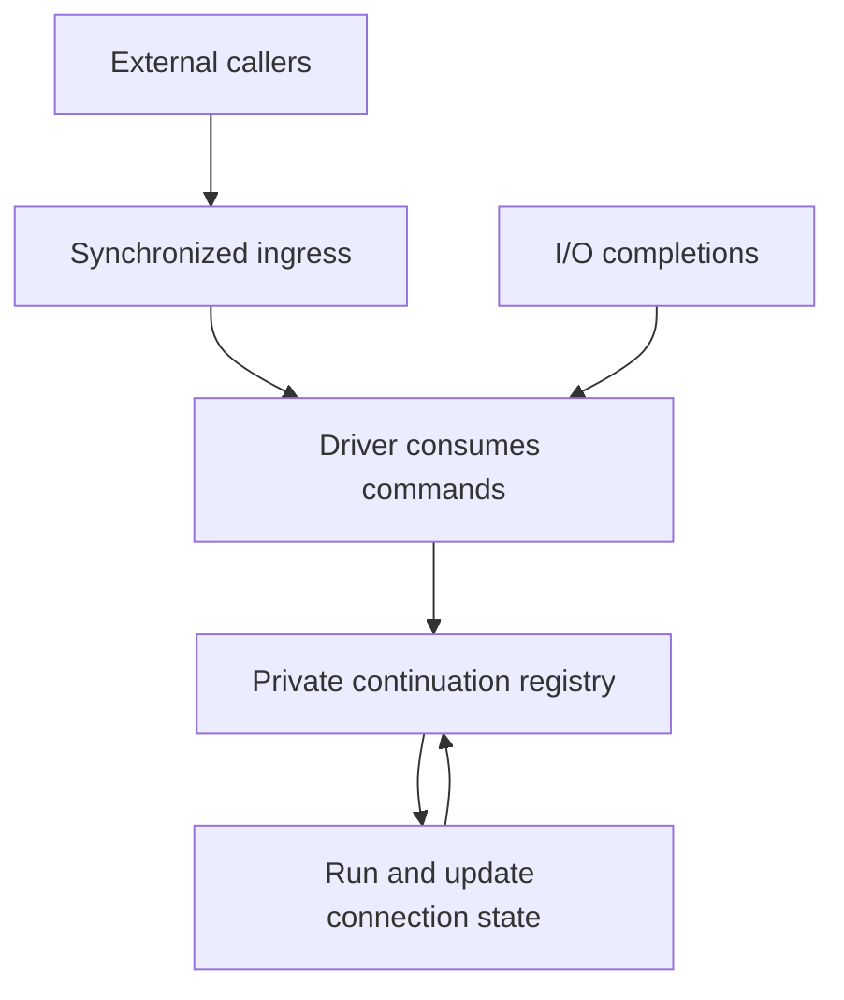

# LeanIn: isolate ownership, publication, and locking costs

Date: 2026-10-20.

Reviewed revision: `41943fa` on `main`.

Status: suggested investigation. Source and repository-reported measurements were reviewed; the experiments below have not been run by this reviewer. The review environment lacked Lean and Nix.

## Recommendation

Before implementing the proposed per-connection trampoline, verify whether publishing it marks its captured continuation cell multi-threaded. Then compare global and driver-private registries while varying locking separately.

The question is not whether a HashMap is slower than an array. It is whether continuation state that executes on one thread is being published through objects that force Lean to treat it as shared, losing exclusive-update opportunities.

Keep the HashMap and operation semantics unchanged for this experiment. Do not combine it with a frame redesign, response-encoding rewrite, or new carrier topology.

## What the latest measurements establish

`docs/PERFORMANCE.md` reports the following individual paired comparisons:

| Change | C=1 | C=8 | C=32 |
| --- | ---: | ---: | ---: |
| UInt32 event fields | +2.8% | +0.5% | +0.9% |
| Deadline slots carrying data rather than closures | +1.6% | +2.5% | +1.2% |
| Activated owner-gated direct writes | -2.8% | +1.1% | -1.5% |
| Completion-first variant | -1.9% | -2.4% | -5.0% |

The first two changes are progress. These rows are not a measured cumulative gain: benchmark the final combined build against the pre-handoff revision to establish that.

The direct-write reachability issue was confirmed with counters, but activating the branch did not improve the serving path. Leave that experiment closed absent new evidence. The completion-first variant also had a reported deadline-semantics issue and should not be treated as an equivalent production candidate.

## Concern: a trampoline does not automatically isolate marking

The latest performance note proposes registering a stable trampoline in the synchronized raw table once per connection. The trampoline captures a per-connection cell, and request continuations are subsequently written into that cell.

This may reduce map operations. It does not inherently avoid multi-thread marking:

| Step | Expected behaviour from the pinned runtime |
| --- | --- |
| Store trampoline in a global registry | Mark newly reachable captures multi-threaded |
| Trampoline captures an ordinary Lean IO.Ref | Mark that reference and its current reachable value multi-threaded |
| Later store a fresh continuation into that reference | Mark the new continuation and its captures multi-threaded |

The reason is explicit in Lean `v4.35.0-rc3`:

- `src/runtime/object.cpp`: `lean_mark_mt` traverses closure environments and `LeanRef` contents.
- `src/runtime/io.cpp`: `ref_maybe_mt` treats both multi-threaded and persistent/global references as potentially shared; `lean_st_ref_put` and `lean_st_ref_swap` mark stored values on that path.
- `src/include/lean/lean.h`: `lean_is_exclusive` returns false for multi-threaded objects.

Already marked objects are skipped by subsequent marking traversals. The concern is publication of each fresh continuation and newly allocated captured state, not an unconditional rescan of the entire old heap on every operation.

Indirection through a normal Lean cell is therefore not an ownership boundary. Do not bypass the runtime's marking rules or use unsafe mutation to manufacture one.

## Experiment 1: check the trampoline premise directly

Build a small, deterministic control on the pinned toolchain:

1. Allocate a cell inside the executing thread and leave it initially empty.
2. Create a callback capturing that cell.
3. Publish the callback into a global registry equivalent to the current raw table.
4. Write fresh continuation/state data into the captured cell.
5. Inspect whether the cell and newly stored state are classified as multi-threaded, and whether a subsequent consumed-state update can use its exclusive path.

Include a positive control where the cell is never published. Use the same fresh-state shape and update in both cases. Retain the published callback observably so the compiler cannot eliminate the publication.

Use generated IR/C and narrowly scoped runtime instrumentation if required. Debug probes must observe without changing the relevant ownership condition: an observing reference can itself defeat exclusivity. Report how the probe avoids that confound. Do not infer ownership solely from source variable names or callback one-shotness.

Expected outcome: ordinary-cell indirection preserves the marking path. If the control disagrees, identify the exact representation or lifetime detail responsible before proceeding.

## Experiment 2: separate locking from publication

The reported replacement of the raw registry's `Std.Mutex` with an `IO.Ref` saved 1,810 instructions/request, approximately 3.1%. That does not, by itself, isolate marking: it also changes lock/unlock, `atomically`, and cleanup machinery. If the replacement reference remained global, its writes still require multi-thread marking.

Keep the same HashMap, callback payload, registration/removal sequence, and workload across this matrix:

| Variant | Ownership / allocation lifetime | Synchronization | Purpose |
| --- | --- | --- | --- |
| A | Current global registry | Std.Mutex | Baseline |
| B | Global registry | IO.Ref without outer lock | Diagnostic lock-removal comparison only |
| C | Allocated within the driver; never published | Std.Mutex | Retain locking while changing shared reachability |
| D | Allocated within the driver; never published | Owner-only IO.Ref | Test the combined owner-local design |

Variant B must not be exposed as a safe public concurrent implementation. Run it only under the controlled single-owner experiment. Thread-safe individual reference operations do not make a compound map read/modify/write atomic.

Variant C is especially informative: a locally allocated mutex that is never published need not have a shared underlying reference merely because it contains a lock. Verify its actual state rather than assuming it. Keep the generated map-operation code comparable where possible.

Interpret comparisons carefully:

- A versus B principally tests removal of the wrapper/locking under global storage, subject to generated-code differences.
- A versus C tests global/shared reachability while retaining the mutex API.
- C versus D tests the remaining locking/wrapper cost under private ownership.
- A versus D gives the combined effect, not an attribution to either factor alone.

Record per-symbol instruction deltas, marking traversal/object counts where available, allocation/copying, and elapsed CPU. A lower total instruction count alone cannot locate the cause.

## Suggested experimental serving architecture

Allocate an owner context inside the driver after takeover. Hold the private registry there and pass the context explicitly through dispatch and managed connection operations.

The private context must not be reachable from global references, shared executor items, or external handles. Sending the context through an ordinary shared queue can defeat the experiment before the first request runs.

Keep current public raw operations on their existing synchronized path initially. Introduce an internal owner-only path for compiled managed connections, guarded by an explicit capability or equivalent API boundary. This avoids weakening public thread-safety to optimize the single-owner case.

External notices can carry IDs and command payloads to the owner; distinguish notices from ownership of the registry itself. Data that genuinely crosses threads may need marking. The objective is to avoid marking state that never crosses, not to remove required synchronization.

Audit:

- Who creates, owns, and disposes the context.
- How takeover and release transfer responsibility.
- Whether any spawned task or callback publishes the private context transitively.
- How external cancellation and stop reach the owner.
- Pending read/write cleanup and exactly-once resumption.
- Compatibility with pump-driven and virtual-clock entry modes.
- Reference cycles between a registry and callbacks capturing its context, and how terminal cleanup breaks them.

Do not assume that an object previously marked multi-threaded becomes exclusive again after other references are removed. The pinned runtime's ordinary exclusivity test does not provide that demotion.

## Performance interpretation

The new profile reports approximately 14.7% of instructions in decrement handling, 7.7% in freeing, 7.3% in marking, and 4.1% in allocation.

These are instruction shares, not elapsed-time ceilings. Removing publication can reduce marking and preserve reuse, indirectly affecting copying, allocation, and later decrements. Conversely, removing many cheap instructions may have little effect on elapsed time. Measure the causal chain instead of predicting a speedup from the symbol ranking.

Likewise, the latest README's Node comparison does not establish whether the newest changes accumulated. Compare the combined build at `41943fa` with the pre-handoff build at `5b74698` under the same method, then compare the combined build with Node.

## Validation and decision criteria

Follow `AGENTS.md`, the pinned toolchain, and existing public executor-contract fixtures. State exactly which behavioural checks ran. A build does not establish runtime correspondence or an allocation guarantee.

For each matrix arm record:

| Variant | C | Depth | CPU/request | Requests/s | p50 / p99 | Marking | Allocation / copies | Errors |
| --- | --- | --- | --- | --- | --- | --- | --- | --- |
| A/B/C/D | 1, 8, 32 | 1; optionally 16 | measured | measured | measured | measured | measured | measured |

Use matched accounting windows for CPU and completed requests. Alternate baseline/candidate order, retain spread and paired effect sizes, and check for stale benchmark processes and unrelated load. Report sustained-load behaviour separately from short paired comparisons.

The first success criterion is mechanistic: private state remains private in the runtime representation. The second is lower total CPU/request and a repeatable end-to-end improvement. The third is preservation of cancellation, deadlines, errors, wake responsiveness, and shutdown semantics.

If private ownership removes marking but does not improve elapsed performance, report that and stop treating marking as the primary performance explanation. If private state is still marked, identify the publication edge before changing representations again.

## Requested investigation output

Provide the isolated trampoline control, registry matrix variants, generated-code/runtime evidence, behavioural checks, paired results, and a recommendation. Keep semantic correctness, observed performance, and stronger ownership/allocation claims separate. No merge, publication, or release is required by this suggestion.

## References

- [Reviewed LeanIn revision](https://github.com/scidonia/leanin/tree/41943fa).
- [Latest performance findings](https://github.com/scidonia/leanin/blob/41943fa/docs/PERFORMANCE.md).
- [Raw registry and deadline implementation](https://github.com/scidonia/leanin/blob/41943fa/LeanIn/Runtime/Io.lean).
- [Pinned Lean marking implementation](https://github.com/leanprover/lean4/blob/v4.35.0-rc3/src/runtime/object.cpp).
- [Pinned Lean reference writes](https://github.com/leanprover/lean4/blob/v4.35.0-rc3/src/runtime/io.cpp).
- [Pinned Lean exclusivity checks](https://github.com/leanprover/lean4/blob/v4.35.0-rc3/src/include/lean/lean.h).
- [Pinned Lean mutex wrapper](https://github.com/leanprover/lean4/blob/v4.35.0-rc3/src/Std/Sync/Mutex.lean).
