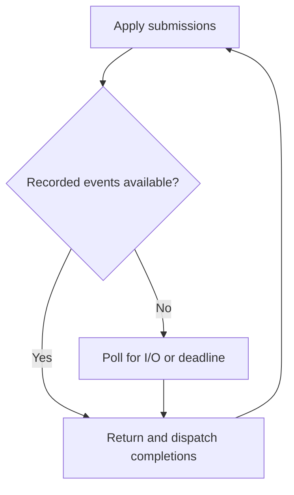
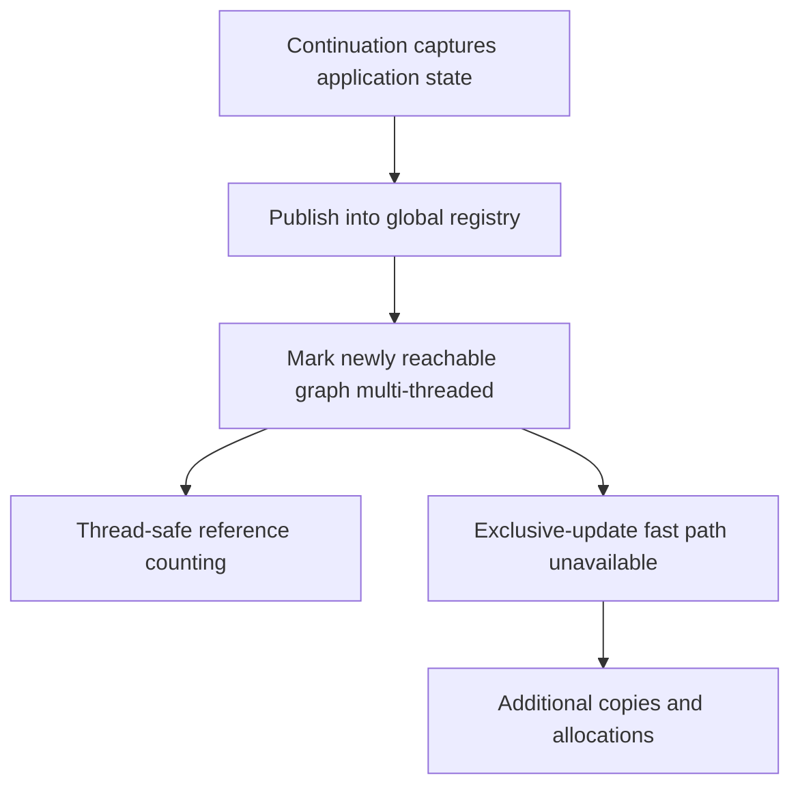

# LeanIn performance candidates: completion representation, loop progress, and ownership

Date: 2026-10-19.

Reviewed revision: `5b7469818bd17b0aa225a44a2208196ccc3b0463` on `main`.

Status: source-grounded investigation proposal. The proposed changes have not been implemented or benchmarked in this review. Lean and Nix were unavailable in the review environment. Existing performance results below are repository reports, not independently reproduced measurements.

## Recommendation

Investigate three candidates in this order:

1. Remove heap-allocated integer boxes from the completion-event bridge.
2. Verify direct-write fast-path reachability and make recorded completions prevent blocking polls.
3. Keep loop-owned continuation state outside unnecessarily shared/global reference graphs.

The first is a small representation experiment. The second addresses concrete control-flow concerns. The third targets multi-thread marking and the loss of exclusive updates, rather than treating all memory-management cost as ordinary allocation or GC.

Do not combine the three into one performance patch. Retain separate results so gains and regressions have attributable causes.

## Baseline and constraints

The current README reports approximately parity with Node at eight concurrent keep-alive connections, a small deficit at one, and a larger deficit at thirty-two. Reported medians are:

| Connections | LeanIn | Node |
| --- | ---: | ---: |
| 1 | 70.0 k requests/s | 72.8 k requests/s |
| 8 | 128.5 k requests/s | 126.9 k requests/s |
| 32 | 116.1 k requests/s | 125.5 k requests/s |

These are distributions on one host, not universal performance claims. The repository records substantial variation, especially in Node's results. Make the primary experiment a paired baseline/candidate comparison; use Node as an external reference after establishing the candidate's effect.

Keep deadline, transport-error, backpressure, and cleanup behaviour equivalent across variants. A faster variant that removes required work is an ablation, not a production improvement.

The repository already records keep-armed reads, a direct-write attempt, deadline changes, fixed-slot registry experiments, protocol rewrites, and carrier experiments. Read the latest entries in `docs/PERFORMANCE.md` before reproducing an old approach. Parts of `docs/notes/LeanIn_Scaling_Theory.md` retain superseded interpretations; use revision-specific code and the later experimental corrections.

## Candidate 1: remove boxed UInt64 event fields

### Source finding

`c/netuv.c`, `np_uv_events`, builds an `Array UInt64`. Each event is a triple of kind, connection ID, and argument, with each field passed through `lean_box_uint64`.

In the pinned Lean runtime (`v4.35.0-rc3`, `src/include/lean/lean.h`), `lean_box_uint64` allocates a constructor holding the scalar. This occurs even for small integers. An ordinary request with one read completion and one write completion therefore entails six integer-box allocations at this bridge, in addition to array and result allocations. Batching events does not eliminate the individual boxes.

### First experiment

Change both sides of the event ABI to `Array UInt32`. On the benchmark's 64-bit platform, `lean_box_uint32` uses immediate values, avoiding separate heap objects.

Audit the range of every event field. Kind and connection ID fit comfortably; byte counts and signed libuv status values need explicit representations and decoding. Preserve negative status semantics rather than truncating the current UInt64 encoding and continuing to use its signed decoder.

Use a packed `ByteArray` or another scalar-array representation only as a subsequent variant if useful. It can remove pointer-array overhead too, but adds decoding considerations. A representation gain must not depend on changing event ordering or delivery semantics.

### Evidence to collect

- Completed requests, event count, and allocations attributed to event construction.
- CPU/request and throughput at C=1, C=8, and C=32, depth 1.
- Depth-16 results as an amortisation control.
- Behavioural checks for successful reads/writes, EOF, negative errors, shutdown, signals, and overflow reporting.

Success means the boxes disappear and end-to-end CPU or throughput improves reproducibly without semantic changes. Do not infer a speedup merely from the lower allocation count. The UInt32 immediate-value advantage is platform-specific; preserve portability or document the target assumption.

## Candidate 2: direct-write eligibility and completion-first progress

### Source finding A: apparent unreachable fast path

`np_uv_writev` requires `g_loop_running` before attempting `uv_try_write`.

At the reviewed revision, the assignments setting that flag true surround selected `uv_run(..., UV_RUN_NOWAIT)` calls. The flag is cleared afterwards. The shim does not invoke Lean continuations from its libuv callbacks; it records events, returns to Lean, and Lean dispatches them.

Consequently, a write submitted by the normal Lean handler appears to arrive with `g_loop_running == 0`. The flag describes a polling phase, not ownership of the loop across event dispatch. Source inspection therefore predicts that the intended serving fast path is not being exercised. Confirm this dynamically before changing it.

### Experiment A: prove which write path runs

Add counters for:

- Total write submissions.
- Fast-path eligibility and attempts.
- Full immediate successes.
- Partial writes, EAGAIN, and other failures.
- Queued fallbacks.

Run the actual server under the normal benchmark. A claimed direct-write gain must be accompanied by nonzero fast-path attempts/successes. If the counter is zero, earlier timing differences cannot be attributed to successful execution of this branch.

### Source finding B: events can exist before a blocking poll

`np_uv_run_once_timeout` applies submissions and subsequently enters `UV_RUN_ONCE`. Applying a submission can itself record an event, such as a read satisfied from the connection's buffered input. A future working direct-write path can also record an immediate write completion.

Recorded events must count as pending progress. Do not block waiting for more I/O before delivering completions already owed to Lean.



The repository's failed self-wake suppression experiment is consistent with a wake currently compensating for a poll entered with deliverable work. This is a hypothesis, not an established explanation. Trace event-queue occupancy at poll entry to distinguish it from other wake/liveness defects.

### Experiment B: implement an explicit progress contract

Use a loop-owner capability or reliable owner-thread check spanning both C polling and Lean dispatch. Do not merely rename or widen `g_loop_running`; off-owner submissions must retain safe queueing and wake behaviour. Ownership must follow takeover, rather than assuming the thread that created the loop remains its owner.

Before enabling immediate writes, audit ordering and accounting. At this revision `c->writes` is incremented in the partial-direct-write branch, but is not a complete accounting mechanism for normal queued/in-flight writes. It is not sufficient to activate the guard without fixing that invariant. Read queue state under the required synchronization.

When a write completes immediately, return or drain its recorded completion before entering a blocking poll. Bound repeated draining so one busy connection does not starve other connections or executor work. Preserve completion order and exactly-once delivery.

### Evidence to collect

- Event-queue occupancy immediately before each blocking poll.
- Poll calls, queued submissions, async wakes, and immediate writes per completed request.
- No blocking-poll entry with an undelivered recorded completion, except a deliberately specified bounded policy that cannot delay its delivery.
- Ordering under two writes to the same connection, partial writes, and EAGAIN.
- Wake responsiveness for off-thread submissions, timers, cancellation, and shutdown.
- Paired CPU/request, throughput, and latency measurements at C=1/8/32.

Do not globally suppress wakes based only on an unsynchronized parked/running flag. Define the queue publication and park protocol before optimizing it.

## Candidate 3: avoid unnecessary multi-thread marking of loop-local state

### Correct the profile interpretation

`lean_mark_mt` is not a tracing-GC collection. It walks newly reachable single-threaded objects and converts their reference counts to Lean's multi-threaded representation.

The pinned runtime establishes two relevant facts:

1. `src/runtime/io.cpp` treats persistent/global references as potentially multi-threaded, and marks values stored into them accordingly (`ref_maybe_mt`, `lean_st_ref_put`, `lean_st_ref_swap`).
2. `src/include/lean/lean.h` makes `lean_is_exclusive` return false for multi-threaded objects.

Thus publishing a continuation into a global reference can mark newly captured protocol data multi-threaded, increasing reference-counting costs and preventing ordinary exclusive-update reuse. The marking traversal skips graphs already marked shared; do not describe it as a full repeated scan of every object on every insertion.

### Connection to current source

`LeanIn/Runtime/Io.lean` contains global initialized stores:

```lean
rawRef   : Std.Mutex RawTable
stallRef : Std.Mutex (Std.TreeMap UInt32 StallSlot)
```

Raw table values are callbacks. Stall slots contain a `fire` action. In `recvStallRaw`, timeout and read continuations refer to the application resume path. Storing these closures makes captured state reachable from those global stores.



This is a concrete mechanism to investigate, not yet attribution of every mark/copy sample. Obtain caller stacks and inspect generated code at the publication boundary.

### First experiment: keep the map, change ownership

Preserve the HashMap representation and change only where its ownership lives:

- Allocate a driver-private context after loop takeover.
- Keep raw registrations and, in a subsequent variant, stall slots owned by that driver.
- Avoid publishing that context through global references or shared worker queues.
- Use the synchronized ingress for genuinely cross-thread commands.
- Route stop/cancel/timeout operations to the owner where necessary, preserving the existing supported entry modes.

A global `IO.Ref` substituted for a global `Std.Mutex` does not solve this. Nor does a newly allocated context help if it is then captured by an item passed through a shared queue. Do not attempt to demote already marked objects or mutate shared objects unsafely.

Make the owner context an explicit parameter or another audited thread-local capability. Account for its lifetime, takeover, pending operations, and shutdown. Avoid introducing unretired reference cycles between a registry and callbacks capturing its context.

### Evidence to collect

- Call paths into `lean_mark_mt` and objects newly marked per request, if instrumentation permits.
- Atomic reference-counting traffic, array-copy allocation, and exclusive-update branches.
- Whether relevant protocol/frame objects remain single-threaded at their update boundaries.
- CPU/request at C=1/8/32 with the same map and the same operation semantics.
- Existing public scenarios for single-carrier, pump-driven/virtual-clock, shutdown, and cross-thread ingress behaviour.

The previous fixed-slot experiments under shared/global storage do not isolate this hypothesis. Do not repeat them as evidence that ownership cannot matter.

## Secondary candidates and deferred work

| Candidate | Recommendation |
| --- | --- |
| `TreeMap.toList` in `stallNext?` and `sweepDue` | Direct traversal can avoid transient list allocation. Rank below the first experiments: cached-minimum work already measured neutral. |
| Generated frame reuse | Reassess after establishing whether publication marks the relevant objects shared. Redesigning a frame cannot force exclusive reuse of a multi-threaded object. |
| More carriers with a wake/inject per completion | Already measured worse. Revisit only with a distinct batching or ownership architecture and a workload that needs it. |
| Fixed slots under the existing global mutex | Already tested. Do not substitute this for the thread-local ownership experiment. |
| Response encoding/header micro-rewrites | Previous variants regressed or had a small isolated ceiling. Do not prioritize without new attribution. |

## Measurement and acceptance

Follow `AGENTS.md` and use the pinned Lean toolchain. Run the existing behavioural gates appropriate to each change, including public executor-contract scenarios; report precisely which checks ran. Do not count a successful build as runtime correctness or source-to-IO correspondence evidence.

Use the existing paired benchmark method with baseline and candidate interleaved on the same host and core placement. Keep response work and deadline behaviour equivalent. Record actual elapsed time, completed requests, errors, CPU/request, and latency; check for surviving benchmark processes and unrelated host load. Match the CPU accounting window to the completion-count window. Use measured elapsed time rather than relying only on the client's configured duration.

At a minimum report:

| Revision / variant | C | Depth | Completed / errors | CPU/request | Requests/s | p50 / p99 | Mechanism counter |
| --- | --- | --- | --- | --- | --- | --- | --- |
| Baseline / candidate | 1, 8, 32 | 1; optionally 16 | measured | measured | measured | measured | boxes, fast writes, polls, or marking |

Count paired signs and report effect sizes and spread. If an effect remains inside noise, call it inconclusive rather than proving the mechanism irrelevant. Separate short controlled comparisons from sustained-load checks.

Success requires both the expected mechanism change and a repeatable end-to-end benefit. Do not precommit to a percentage; determine the attainable gain empirically.

## Deliverable from the investigation

For each candidate, provide the isolated patch or experiment, pinned revisions and commands, behavioural checks, mechanism counters, paired performance results, and a keep/reject/inconclusive recommendation. No remote merge or release is required by this suggestion.

## Source references

- [Reviewed repository revision](https://github.com/scidonia/leanin/tree/5b7469818bd17b0aa225a44a2208196ccc3b0463).
- [C event bridge, loop driver, and write paths](https://github.com/scidonia/leanin/blob/5b7469818bd17b0aa225a44a2208196ccc3b0463/c/netuv.c).
- [Raw callback and deadline registries](https://github.com/scidonia/leanin/blob/5b7469818bd17b0aa225a44a2208196ccc3b0463/LeanIn/Runtime/Io.lean).
- [Driver takeover and execution](https://github.com/scidonia/leanin/blob/5b7469818bd17b0aa225a44a2208196ccc3b0463/LeanIn/Runtime/Basic.lean).
- [Repository performance record](https://github.com/scidonia/leanin/blob/5b7469818bd17b0aa225a44a2208196ccc3b0463/docs/PERFORMANCE.md).
- [Pinned Lean boxing and exclusivity implementation](https://github.com/leanprover/lean4/blob/v4.35.0-rc3/src/include/lean/lean.h).
- [Pinned Lean reference operations](https://github.com/leanprover/lean4/blob/v4.35.0-rc3/src/runtime/io.cpp).
- [Pinned Lean multi-thread marking implementation](https://github.com/leanprover/lean4/blob/v4.35.0-rc3/src/runtime/object.cpp).
- [Pinned Lean mutex wrapper](https://github.com/leanprover/lean4/blob/v4.35.0-rc3/src/Std/Sync/Mutex.lean).
